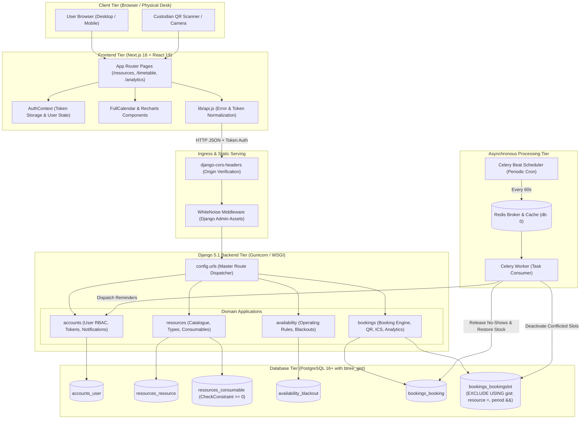
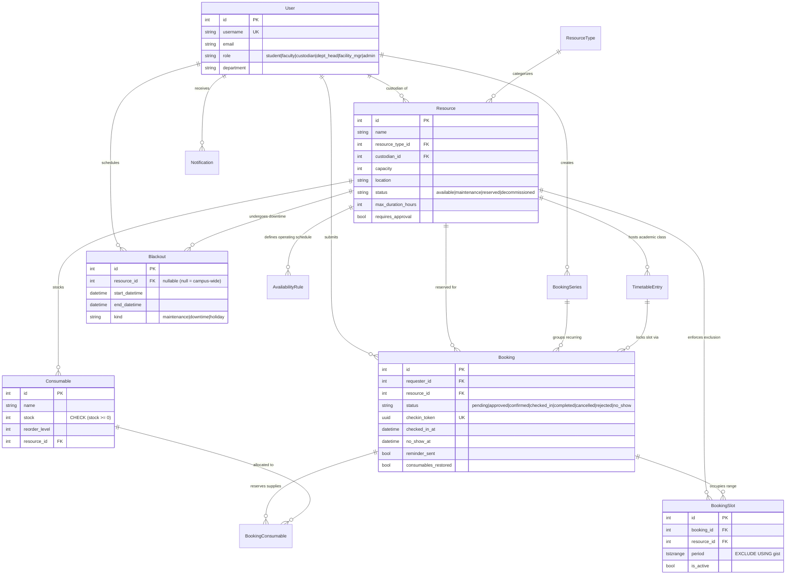

# PROJECT KNOWLEDGE BASE: P20 UNIFIED CAMPUS RESOURCE & FACILITY BOOKING PLATFORM

> **Document Type:** Central Knowledge Base & AI Assistant Handoff Guide  
> **Repository Location:** Project Root (`PROJECT_KNOWLEDGE_BASE.md`)  
> **Last Verified & Updated:** November 19, 2026  
> **Platform Version:** Sprint 7 / Production Candidate (Vercel + Render Deployment)  
> **Target Audience:** Incoming AI Assistants (ChatGPT, Claude, Gemini, etc.), University Evaluators, and Core Maintainers

---

## 1. Project Overview

### 1.1 Project Identification
- **Project Name:** P20 (Campus Resource, Laboratory & Facility Management Platform)
- **Project Title:** Unified Campus Resource, Laboratory & Facility Booking Platform
- **Domain:** Higher Education Infrastructure, Academic Scheduling, IoT/QR Physical Access & Resource Contention Management
- **Academic Context:** Developed under Lovely Professional University (LPU) Capstone / Recognition of Prior Learning (RPL) specifications.
- **Repository Visibility / Scope:** Full-stack monorepo containing Django REST Framework backend, Next.js 16 frontend, PostgreSQL database schema with GiST exclusion constraints, Celery background tasks, and Docker deployment artifacts.

### 1.2 Purpose & Problem Statement
Modern university campuses suffer from fragmented, manual, or poorly synchronized booking mechanisms for high-value physical infrastructure:
1. **Double-Booking & Race Conditions:** In traditional ORM-level reservation systems, concurrent requests create overlapping reservations because checking availability and inserting records are not atomic at the storage engine level.
2. **Academic Timetable Clashes:** Academic semester courses are often disconnected from ad-hoc student and faculty booking portals, resulting in students booking rooms already allocated to scheduled classes.
3. **No-Show Wastage:** Users reserve high-demand facilities (AI/GPU labs, 3D printers, seminar halls) but fail to attend, locking out peers while the physical room sits idle.
4. **Maintenance Blindspots:** Emergency electrical repairs or scheduled campus blackouts often fail to notify active reservation holders, leading to stranded students and wasted setup time.
5. **Consumable Depletion:** Lab bookings frequently require consumable supplies (3D filament, markers, VR sensor batteries) with no inventory linkage, causing sessions to fail due to missing supplies.

### 1.3 Main Objectives & Expected Outcomes
- **Mathematical Double-Booking Prevention:** Guarantee zero overlapping bookings for any physical resource via PostgreSQL GiST range exclusion constraints (`EXCLUDE USING gist`) evaluated at the database kernel level.
- **Role-Based Campus Portal:** Provide a single unified interface with strict role-based access control (RBAC) across 6 institutional user personas.
- **Autonomous Lifecycle Automation:** Implement background workers (Celery + Celery Beat) to automatically release bookings whose holders fail to check in within a configurable grace window (default: 30 minutes).
- **Physical QR Check-In:** Equip resource custodians and room entrances with cryptographic UUID-encoded QR verification tokens.
- **Institutional Analytics:** Provide real-time data on resource utilization %, peak hours, weekday intensity, and CSV reporting for departmental audit and budget planning.

### 1.4 Target Users & Institutional Roles
Verified against [backend/accounts/models.py](file:///d:/Django%20Rpl/backend/accounts/models.py#L4-L26) and [backend/accounts/permissions.py](file:///d:/Django%20Rpl/backend/accounts/permissions.py#L4-L26):

| Role Identifier | Role Display | System Capabilities & Jurisdictions |
|---|---|---|
| `student` | Student | Browse catalogue, check live availability, submit single/recurring requests, view owned reservations, generate QR check-in pass, cancel owned bookings. |
| `faculty` | Faculty / Staff | Same as student, plus bypass standard duration caps when permitted, reserve equipment for academic cohorts. |
| `custodian` | Resource Custodian | Manage physical inventory for assigned campus resources; review, approve, or reject pending reservations; operate Check-in Desk; manage consumables. |
| `dept_head` | Department Head | Review department-wide booking queues, approve cross-department resource access, review departmental utilization KPIs. |
| `facility_mgr` | Facility Manager | Manage campus-wide physical infrastructure, schedule blackout/maintenance windows, override holds, perform desk check-ins across all facilities. |
| `admin` | Administrator | Full platform superuser privileges, timetable CSV batch import, manual role elevation, audit logs, system-wide analytics. |

---

## 2. Technology Stack

Every component listed below has been verified directly in the project configuration and dependency manifests.

### 2.1 Backend Architecture
- **Language:** Python 3.13.x (Verified in [backend/Dockerfile](file:///d:/Django%20Rpl/backend/Dockerfile#L1) and [requirements.txt](file:///d:/Django%20Rpl/requirements.txt#L1))
- **Core Web Framework:** Django 5.1.x ([backend/config/settings.py](file:///d:/Django%20Rpl/backend/config/settings.py#L28-L47))
- **API Engine:** Django REST Framework (DRF) 3.15.x
- **Token Authentication:** `rest_framework.authtoken` with multi-identity fallback
- **Cross-Origin Resource Sharing:** `django-cors-headers` 4.3+
- **Static File Engine:** WhiteNoise 6.6+ with `CompressedStaticFilesStorage`
- **WSGI Production Server:** Gunicorn 21.2+ (`gunicorn config.wsgi:application`)

### 2.2 Database & Storage Invariants
- **Database Engine:** PostgreSQL 16+ (Docker) / PostgreSQL 18+ (Local Development & Render Cloud)
- **Key Database Extension:** `btree_gist` (Required for mixing scalar foreign keys with range types in exclusion constraints)
- **Range Types:** PostgreSQL `tstzrange` via Django's `DateTimeRangeField`
- **Database Connector:** `psycopg2-binary` 2.9.9+ and `dj-database-url` 2.1.0

### 2.3 Background Processing, Scheduling & Caching
- **Task Queue:** Celery 5.3.6+ ([backend/config/celery.py](file:///d:/Django%20Rpl/backend/config/celery.py))
- **Message Broker & Results Backend:** Redis 7.x (`redis://127.0.0.1:6379/0`)
- **Scheduler:** Celery Beat (`release-no-shows-every-minute`, `send-booking-reminders-every-minute` configured in [backend/config/settings.py](file:///d:/Django%20Rpl/backend/config/settings.py#L185-L194))
- **Cloud Graceful Degradation:** `CELERY_TASK_ALWAYS_EAGER = True` support for environments without standalone Redis instances (e.g. Render free tier).

### 2.4 Frontend Stack
- **Framework:** Next.js 16.3.5 (App Router, Webpack builder enabled)
- **Runtime & UI Library:** React 19.2.8, React DOM 19.2.8
- **Styling Engine:** Tailwind CSS v4 (`@tailwindcss/postcss`) with custom LPU palette and frosted glassmorphic styling
- **Calendar & Scheduling:** FullCalendar v6 (`@fullcalendar/react`, `@fullcalendar/daygrid`, `@fullcalendar/timegrid`, `@fullcalendar/interaction`)
- **Visual Analytics:** Recharts 3.10.1 (Bar charts, Donut charts, Utilization graphs)
- **QR Code Engine:** `qrcode` (Python backend SVG rendering) & HTML5 Canvas/Video scanner integration

### 2.5 Containerization & Cloud Deployment
- **Container Engine:** Docker & Docker Compose v2 ([docker-compose.yml](file:///d:/Django%20Rpl/docker-compose.yml))
- **Cloud Backend Host:** Render Web Service (Docker runtime, [render.yaml](file:///d:/Django%20Rpl/render.yaml))
- **Cloud Frontend Host:** Vercel (Next.js Edge/Serverless platform)
- **Continuous Integration:** GitHub Actions ([.github/workflows/ci.yml](file:///d:/Django%20Rpl/.github/workflows/ci.yml))

---

## 3. Complete Project Folder Structure

```text
D:\Django Rpl\
├── .env                              # Local environment variables (PostgreSQL, Redis, Secret Key)
├── .env.example                      # Sanitized environment template for onboarding
├── .gitignore                        # Git ignore rules (excludes .venv, node_modules, media, etc.)
├── docker-compose.yml                # Full local 5-container production emulation stack
├── Dockerfile                        # Root Dockerfile for default cloud deployment detection
├── locustfile.py                     # 500-user concurrency benchmark suite
├── manage.py                         # (Root alias, points to backend execution)
├── open_psql.bat                     # Convenience script to launch local psql shell
├── render.yaml                       # Infrastructure-as-code blueprint for Render deployment
├── requirements.txt                  # Locked Python backend dependencies
├── run_locust.bat                    # One-click execution script for load testing
├── start_servers.bat                 # One-click dual server startup script (Django + Next.js)
├── stop_servers.bat                  # One-click teardown script for background dev processes
│
├── .github/
│   └── workflows/
│       └── ci.yml                    # Automated 3-stage GitHub Actions CI pipeline
│
├── backend/
│   ├── manage.py                     # Primary Django management script
│   ├── build.sh                      # Shell build script for cloud PaaS (collectstatic + migrate)
│   ├── entrypoint.sh                 # Docker container bootstrap script with TCP port waiting
│   ├── Dockerfile                    # Multi-stage Python 3.13 backend image definition
│   │
│   ├── config/                       # Core Django project configuration package
│   │   ├── __init__.py               # Initializes Celery app export
│   │   ├── asgi.py                   # ASGI application entrypoint
│   │   ├── celery.py                 # Celery worker and autodiscovery configuration
│   │   ├── settings.py               # Comprehensive Django settings (WhiteNoise, CORS, DB, Celery)
│   │   ├── tests.py                  # Integration and root endpoint tests (7 tests)
│   │   ├── urls.py                   # Master routing table including API routes
│   │   ├── views.py                  # Root API landing view (`/`) and health check (`/api/health/`)
│   │   └── wsgi.py                   # WSGI application entrypoint for Gunicorn
│   │
│   ├── accounts/                     # User management, roles, and notification app
│   │   ├── admin.py                  # Custom User and Notification Django Admin registration
│   │   ├── apps.py                   # App configuration
│   │   ├── models.py                 # Custom User model (6 roles) and Notification model
│   │   ├── notifications.py          # Notification creation and email dispatch service
│   │   ├── permissions.py            # DRF role-based permission classes (IsStudent, IsAdmin, etc.)
│   │   ├── serializers.py            # User, Login, Register, RoleUpdate, Notification serializers
│   │   ├── tests.py                  # Authentication and security test suite (11 tests)
│   │   ├── urls.py                   # Endpoints: login, register, forgot-password, reset-password, me
│   │   ├── views.py                  # Auth views, password reset views, notification handlers
│   │   └── management/commands/
│   │       └── seed_demo_users.py    # Seeds accounts for all 6 roles (both clean & demo usernames)
│   │
│   ├── resources/                    # Resource catalogue, categories, and consumables
│   │   ├── admin.py                  # Resource, ResourceType, Consumable admin with maintenance indicators
│   │   ├── apps.py                   # App configuration
│   │   ├── models.py                 # ResourceType, Resource (with dynamic maintenance status), Consumable
│   │   ├── permissions.py            # Custodian and facility manager permission checks
│   │   ├── serializers.py            # ResourceList, ResourceDetail, Consumable serializers
│   │   ├── tests.py                  # Catalogue and consumable test suite (18 tests)
│   │   ├── urls.py                   # Endpoints: types, resources, consumables, maintenance
│   │   ├── views.py                  # Resource CRUD, filtering, consumable inventory & stock adjustment
│   │   └── management/commands/
│   │       └── seed_resources.py     # Seeds realistic campus infrastructure (Labs, Halls, Equipment)
│   │
│   ├── availability/                 # Operating hours, schedules, and blackout periods
│   │   ├── admin.py                  # AvailabilityRule and Blackout admin configuration
│   │   ├── apps.py                   # App configuration
│   │   ├── models.py                 # AvailabilityRule (day/time windows), Blackout (downtime windows)
│   │   ├── serializers.py            # AvailabilityRule and Blackout serializers
│   │   ├── tests.py                  # Operating rules and blackout test suite (12 tests)
│   │   ├── urls.py                   # Endpoints: blackouts, maintenance
│   │   ├── views.py                  # Blackout CRUD, conflict auto-cancellation
│   │   └── management/commands/
│   │       └── seed_availability.py  # Seeds campus operating schedules and non-blocking blackout windows
│   │
│   ├── bookings/                     # Booking engine, GiST range exclusion, approvals & analytics
│   │   ├── admin.py                  # Booking, BookingSlot, BookingSeries, TimetableEntry admin
│   │   ├── analytics.py              # Statistical aggregation engine (KPIs, peak hours, utilization %)
│   │   ├── analytics_views.py        # Analytics dashboard and CSV export endpoints
│   │   ├── apps.py                   # App configuration
│   │   ├── models.py                 # Booking (source, checkout tracking), BookingSlot (GiST exclusion), BookingSeries
│   │   ├── serializers.py            # BookingCreate, BookingSlot, CheckIn, CheckOut, Series serializers
│   │   ├── tasks.py                  # Celery background tasks (release_no_shows, send_booking_reminders)
│   │   ├── tests.py                  # Comprehensive booking engine & check-in/out test suite (62 tests)
│   │   ├── urls.py                   # Endpoints: bookings, check-in-dashboard, check-in, check-out, approve, reject
│   │   ├── views.py                  # Booking lifecycle, manual check-in/out, desk dashboard, availability feed
│   │   └── management/commands/
│   │       └── process_no_shows.py   # CLI fallback command for no-show release without Celery
│   │
│   ├── permissionslips/              # Official University Permission Slip System & Room Allocation
│   │   ├── admin.py                  # PermissionSlip, PermissionSlipAuditLog Django Admin registration
│   │   ├── apps.py                   # App configuration
│   │   ├── models.py                 # PermissionSlip (with document validator), PermissionSlipAuditLog
│   │   ├── serializers.py            # PermissionSlipSerializer, Create, Verify, Reject, Allocate serializers
│   │   ├── tests.py                  # Permission slip submission, verification, conflict override test suite (6 tests)
│   │   ├── urls.py                   # Endpoints: list/create, detail, review, verify, reject, conflicts, allocate
│   │   └── views.py                  # Slip lifecycle views, conflict analysis, atomic displacement & allocation
│   │
│   └── staticfiles/                  # Pre-collected static assets for WhiteNoise serving in production
│
├── docker/
│   └── init-db.sql                   # SQL script to ensure `CREATE EXTENSION IF NOT EXISTS btree_gist;`
│
├── docs/
│   ├── performance.md                # Comprehensive 500-user load test report with latency tables
│   ├── locust_500_run_stats.csv      # Raw CSV performance statistics from Locust benchmark
│   └── ...                           # Supplementary Locust CSV runs and metrics
│
└── frontend/                         # Next.js 16 Client Portal
    ├── package.json                  # Frontend dependencies and npm scripts
    ├── next.config.mjs               # Next.js configuration (Webpack builder mode enabled)
    ├── Dockerfile                    # Multi-stage production container for Next.js
    ├── .env.local                    # Local frontend API base URL override
    │
    ├── context/
    │   └── AuthContext.js            # Global authentication state, localStorage token sync, user profile
    │
    ├── lib/
    │   └── api.js                    # Unified REST client with error normalization and DRF token injector
    │
    ├── tests/
    │   └── booking-form.test.mjs     # Native Node.js test suite for frontend form validation (6 tests)
    │
    ├── components/                   # Reusable UI component library
    │   ├── Header.jsx                # Top bar with notifications bell, user profile pill, and logout
    │   ├── Sidebar.jsx               # Navigation drawer with dynamic role-filtered navigation links
    │   ├── ResourceCard.jsx          # Resource presentation card with status indicator and specs
    │   ├── FilterPanel.jsx           # Multi-criteria search and filter toolbar for resource catalogue
    │   ├── SearchBar.jsx             # Debounced search input
    │   ├── StatusBadge.jsx           # Standardized status badge (Available, Maintenance, Pending, etc.)
    │   ├── ConfirmModal.jsx          # Reusable confirmation dialog for dangerous actions (cancel, reject)
    │   ├── ResourceFormModal.jsx     # Staff modal for adding or editing resources
    │   ├── LoadingState.jsx          # Skeleton loading state
    │   └── ErrorState.jsx            # Standardized error presentation banner
    │
    └── app/                          # Next.js App Router route hierarchy
        ├── layout.jsx                # Root HTML layout wrapping AuthProvider
        ├── globals.css               # Global Tailwind CSS definitions and custom scrollbars
        ├── page.jsx                  # Root landing page (redirects authenticated users to /dashboard)
        ├── login/page.jsx            # Redesigned frosted glassmorphic auth page (Login, Register, Forgot)
        ├── dashboard/page.jsx        # Role-customized dashboard overview with quick KPIs and shortcuts
        ├── resources/page.jsx        # Interactive searchable resource catalogue
        ├── resources/[id]/page.jsx   # Resource specifications and custodian contact page
        ├── resources/[id]/availability/page.jsx # FullCalendar scheduling screen with official allocation badge
        ├── my-bookings/page.jsx      # User booking manager, check-in & check-out actions, official badges
        ├── permission-slips/page.jsx # Permission slip submission form & user's submitted slips list
        ├── permission-slips/verify/page.jsx # Administrative verification dashboard & conflict override room allocation
        ├── approvals/page.jsx        # Custodian and staff queue for approving/rejecting requests
        ├── check-in/page.jsx         # Physical check-in & check-out desk interface with attendance timeline
        ├── maintenance/page.jsx      # Downtime and blackout window manager with auto-cancellation
        ├── timetable/page.jsx        # Academic timetable CSV batch import and conflict preview
        ├── consumables/page.jsx      # Lab consumables inventory manager with low-stock warnings
        └── analytics/page.jsx        # Executive analytics dashboard with Recharts visualizations
```

---

## 4. System Architecture

### 4.1 Architectural Pattern
The platform implements a **Decoupled Client-Server Architecture**:
1. **Frontend Tier:** Single Page Application (SPA) built on Next.js 16 utilizing React 19. The UI communicates strictly over asynchronous JSON HTTP requests to the REST API, storing authentication tokens in browser `localStorage`.
2. **Application Tier:** Stateless Django 5.1 REST Framework backend. Authentication state is validated per-request using database-backed bearer tokens (`Token <key>`). Business logic is compartmentalized across four focused domain applications: `accounts`, `resources`, `availability`, and `bookings`.
3. **Database Tier (Storage Engine Level Invariants):** PostgreSQL 16+ utilizing GiST spatial/range indexes and `DateTimeRangeField` to mathematically enforce single-occupancy reservations directly inside the ACID transaction engine.
4. **Asynchronous Background Tier:** Celery worker and Celery Beat daemon connected over a Redis broker to run periodic background sweeps for automated check-in releases and email reminders.

### 4.2 Comprehensive System Architecture Diagram



---

## 5. Django Backend Documentation

### 5.1 Django Configuration Details
- **Project Configuration Root:** [backend/config/](file:///d:/Django%20Rpl/backend/config/)
- **Installed Apps:** Verified in `settings.py`:
  - `django.contrib.admin`, `django.contrib.auth`, `django.contrib.contenttypes`, `django.contrib.sessions`, `django.contrib.messages`, `django.contrib.staticfiles`, `django.contrib.postgres`
  - `rest_framework`, `rest_framework.authtoken`, `corsheaders`
  - `accounts.apps.AccountsConfig`, `resources.apps.ResourcesConfig`, `bookings.apps.BookingsConfig`, `availability.apps.AvailabilityConfig`
- **Middleware Pipeline:**
  1. `corsheaders.middleware.CorsMiddleware` (Must precede all response-generating middleware)
  2. `django.middleware.security.SecurityMiddleware`
  3. `whitenoise.middleware.WhiteNoiseMiddleware` (Static asset delivery with compression)
  4. `django.contrib.sessions.middleware.SessionMiddleware`
  5. `django.middleware.common.CommonMiddleware`
  6. `django.middleware.csrf.CsrfViewMiddleware`
  7. `django.contrib.auth.middleware.AuthenticationMiddleware`
  8. `django.contrib.messages.middleware.MessageMiddleware`
  9. `django.middleware.clickjacking.XFrameOptionsMiddleware`
- **REST Framework Defaults:**
  - Default Authentication: `TokenAuthentication`, `SessionAuthentication`
  - Default Permission: `IsAuthenticated` (Specific views override with `AllowAny` or custom RBAC)

---

### 5.2 Implemented API Endpoints Reference Table

Every endpoint below exists in the repository source code:

| HTTP Method | API Route | Purpose & Function | Access / Permission | Source Implementation File |
|---|---|---|---|---|
| `GET` | `/` | API root landing view displaying status and route catalogue | `AllowAny` | [backend/config/views.py](file:///d:/Django%20Rpl/backend/config/views.py) |
| `GET` | `/api/health/` | System liveness probe returning database connectivity status | `AllowAny` | [backend/config/views.py](file:///d:/Django%20Rpl/backend/config/views.py) |
| `POST` | `/api/accounts/register/` | Self-service registration (enforces `student` role by default) | `AllowAny` | [backend/accounts/views.py](file:///d:/Django%20Rpl/backend/accounts/views.py) |
| `POST` | `/api/accounts/login/` | User authentication with dual fallback (`student` / `demo_student`) | `AllowAny` | [backend/accounts/views.py](file:///d:/Django%20Rpl/backend/accounts/views.py) |
| `POST` | `/api/accounts/logout/` | Invalidate current user auth token | `IsAuthenticated` | [backend/accounts/views.py](file:///d:/Django%20Rpl/backend/accounts/views.py) |
| `POST` | `/api/accounts/forgot-password/`| Generate password reset token and dispatch email/notification | `AllowAny` | [backend/accounts/views.py](file:///d:/Django%20Rpl/backend/accounts/views.py) |
| `POST` | `/api/accounts/reset-password/` | Validate token and set new password securely | `AllowAny` | [backend/accounts/views.py](file:///d:/Django%20Rpl/backend/accounts/views.py) |
| `GET` | `/api/accounts/me/` | Retrieve authenticated user profile, department, and role | `IsAuthenticated` | [backend/accounts/views.py](file:///d:/Django%20Rpl/backend/accounts/views.py) |
| `GET` | `/api/accounts/roles/` | List valid system roles and display labels | `AllowAny` | [backend/accounts/views.py](file:///d:/Django%20Rpl/backend/accounts/views.py) |
| `GET` | `/api/accounts/dashboard-stats/` | Quick KPI metric counters scoped to active role | `IsAuthenticated` | [backend/accounts/views.py](file:///d:/Django%20Rpl/backend/accounts/views.py) |
| `PATCH`| `/api/accounts/users/<id>/role/`| Elevate or modify user role | `admin` only | [backend/accounts/views.py](file:///d:/Django%20Rpl/backend/accounts/views.py) |
| `GET` | `/api/accounts/notifications/` | List notifications for authenticated user with unread counter | `IsAuthenticated` | [backend/accounts/views.py](file:///d:/Django%20Rpl/backend/accounts/views.py) |
| `POST` | `/api/accounts/notifications/<id>/read/` | Mark individual notification as read | `IsAuthenticated` | [backend/accounts/views.py](file:///d:/Django%20Rpl/backend/accounts/views.py) |
| `POST` | `/api/accounts/notifications/mark-all-read/` | Mark all unread notifications as read in bulk | `IsAuthenticated` | [backend/accounts/views.py](file:///d:/Django%20Rpl/backend/accounts/views.py) |
| `GET` | `/api/resources/types/` | List all resource categories/types | `AllowAny` | [backend/resources/views.py](file:///d:/Django%20Rpl/backend/resources/views.py) |
| `POST` | `/api/resources/types/` | Create a new resource category | `admin`, `facility_mgr` | [backend/resources/views.py](file:///d:/Django%20Rpl/backend/resources/views.py) |
| `GET` | `/api/resources/` | Search & filter resource catalogue (`search`, `status`, `capacity`) | `AllowAny` | [backend/resources/views.py](file:///d:/Django%20Rpl/backend/resources/views.py) |
| `POST` | `/api/resources/` | Create a new physical resource | `admin`, `facility_mgr` | [backend/resources/views.py](file:///d:/Django%20Rpl/backend/resources/views.py) |
| `GET` | `/api/resources/<id>/` | Detailed resource view with custodian info and feature tags | `AllowAny` | [backend/resources/views.py](file:///d:/Django%20Rpl/backend/resources/views.py) |
| `PUT/PATCH`| `/api/resources/<id>/` | Update resource metadata, status, or capacity | Custodian, Admin | [backend/resources/views.py](file:///d:/Django%20Rpl/backend/resources/views.py) |
| `DELETE`| `/api/resources/<id>/` | Delete physical resource | `admin` only | [backend/resources/views.py](file:///d:/Django%20Rpl/backend/resources/views.py) |
| `GET` | `/api/resources/<id>/availability/` | FullCalendar event feed (slots, holds, blackouts) | `AllowAny` | [backend/bookings/views.py](file:///d:/Django%20Rpl/backend/bookings/views.py) |
| `GET` | `/api/resources/consumables/` | List lab consumables inventory with low-stock alerts | `IsAuthenticated` | [backend/resources/views.py](file:///d:/Django%20Rpl/backend/resources/views.py) |
| `POST` | `/api/resources/consumables/` | Add new consumable item to inventory | Custodian, Admin | [backend/resources/views.py](file:///d:/Django%20Rpl/backend/resources/views.py) |
| `PATCH`| `/api/resources/consumables/<id>/` | Modify consumable name, unit, or reorder threshold | Custodian, Admin | [backend/resources/views.py](file:///d:/Django%20Rpl/backend/resources/views.py) |
| `POST` | `/api/resources/consumables/<id>/adjust-stock/` | Atomic stock level delta adjustment (+/- quantity) | Custodian, Admin | [backend/resources/views.py](file:///d:/Django%20Rpl/backend/resources/views.py) |
| `GET` | `/api/availability/blackouts/` | List scheduled maintenance and holiday blackouts | `IsAuthenticated` | [backend/availability/views.py](file:///d:/Django%20Rpl/backend/availability/views.py) |
| `POST` | `/api/availability/blackouts/` | Schedule downtime window (supports `cancel_conflicting=true`) | Staff, Admin | [backend/availability/views.py](file:///d:/Django%20Rpl/backend/availability/views.py) |
| `DELETE`| `/api/availability/blackouts/<id>/` | Remove downtime window and restore resource availability | Staff, Admin | [backend/availability/views.py](file:///d:/Django%20Rpl/backend/availability/views.py) |
| `GET` | `/api/bookings/` | List personal bookings for authenticated user | `IsAuthenticated` | [backend/bookings/views.py](file:///d:/Django%20Rpl/backend/bookings/views.py) |
| `POST` | `/api/bookings/` | Create reservation (single or recurring series; returns 201 or 409) | `IsAuthenticated` | [backend/bookings/views.py](file:///d:/Django%20Rpl/backend/bookings/views.py) |
| `GET` | `/api/bookings/<id>/` | View individual booking details with status and allocated stock | Owner, Staff, Admin | [backend/bookings/views.py](file:///d:/Django%20Rpl/backend/bookings/views.py) |
| `POST` | `/api/bookings/<id>/cancel/` | Cancel booking (supports `cancel_series=true`), releasing slot | Owner, Staff, Admin | [backend/bookings/views.py](file:///d:/Django%20Rpl/backend/bookings/views.py) |
| `GET` | `/api/bookings/manage/` | Filter managed booking queues (`status=pending`, etc.) | Custodian, Dept, Mgr | [backend/bookings/views.py](file:///d:/Django%20Rpl/backend/bookings/views.py) |
| `POST` | `/api/bookings/<id>/approve/` | Approve pending reservation request | Custodian, Dept, Mgr | [backend/bookings/views.py](file:///d:/Django%20Rpl/backend/bookings/views.py) |
| `POST` | `/api/bookings/<id>/reject/` | Reject pending reservation with mandatory explanation note | Custodian, Dept, Mgr | [backend/bookings/views.py](file:///d:/Django%20Rpl/backend/bookings/views.py) |
| `GET` | `/api/bookings/<id>/qr/` | Generate SVG/PNG binary QR check-in pass (pass `?format=json`) | Owner, Staff | [backend/bookings/views.py](file:///d:/Django%20Rpl/backend/bookings/views.py) |
| `POST` | `/api/bookings/check-in/` | Check in via UUID token (`{"token": "<uuid>"}`) | Owner, Custodian | [backend/bookings/views.py](file:///d:/Django%20Rpl/backend/bookings/views.py) |
| `POST` | `/api/bookings/<id>/check-in/` | Desk check-in using booking primary key | Custodian, Admin | [backend/bookings/views.py](file:///d:/Django%20Rpl/backend/bookings/views.py) |
| `GET` | `/api/bookings/export.ics` | Export all personal bookings as iCalendar feed (.ics) | `IsAuthenticated` | [backend/bookings/views.py](file:///d:/Django%20Rpl/backend/bookings/views.py) |
| `GET` | `/api/bookings/<id>/export.ics` | Export single booking as standard RFC 5545 iCalendar file | `IsAuthenticated` | [backend/bookings/views.py](file:///d:/Django%20Rpl/backend/bookings/views.py) |
| `POST` | `/api/bookings/timetable/import/` | CSV batch import of semester academic schedule holds | `admin` only | [backend/bookings/views.py](file:///d:/Django%20Rpl/backend/bookings/views.py) |
| `GET` | `/api/bookings/timetable/` | List active timetable holds by resource or semester | `IsAuthenticated` | [backend/bookings/views.py](file:///d:/Django%20Rpl/backend/bookings/views.py) |
| `GET` | `/api/bookings/analytics/dashboard/` | Utilization %, peak hours, weekday demand, KPI summaries | Custodian, Dept, Admin | [backend/bookings/analytics_views.py](file:///d:/Django%20Rpl/backend/bookings/analytics_views.py) |
| `GET` | `/api/bookings/reports/bookings/export-csv/` | Download comprehensive booking logs as CSV | Custodian, Dept, Admin | [backend/bookings/analytics_views.py](file:///d:/Django%20Rpl/backend/bookings/analytics_views.py) |
| `GET` | `/api/bookings/reports/usage/export-csv/` | Download resource capacity and operating utilization CSV | Custodian, Dept, Admin | [backend/bookings/analytics_views.py](file:///d:/Django%20Rpl/backend/bookings/analytics_views.py) |

---

## 6. Database Documentation

### 6.1 Database Schema & Entity-Relationship Model
The schema leverages PostgreSQL-specific range types to guarantee mathematical non-overlapping intervals:



### 6.2 Key Constraints & Invariants
1. **The GiST Range Exclusion Constraint (`prevent_overlapping_booking_slots`):**
   - Implemented on `bookings_bookingslot` in [backend/bookings/models.py](file:///d:/Django%20Rpl/backend/bookings/models.py#L330-L339):
     ```python
     ExclusionConstraint(
         name='prevent_overlapping_booking_slots',
         expressions=[
             ('resource', '='),
             ('period', '&&'),
         ],
         condition=models.Q(is_active=True),
     )
     ```
   - **Operational Mechanism:** Two active booking slots for the same resource cannot have overlapping `DateTimeRangeField` intervals (`period && period`). When a clash occurs, PostgreSQL immediately raises an `ExclusionViolation` error. The DRF view catches this and returns `HTTP 409 Conflict`.
2. **Consumable Non-Negative Check (`consumable_stock_non_negative`):**
   - Enforced on `resources_consumable`: `CHECK (stock >= 0)`. Stock deductions use atomic `select_for_update()` to prevent negative inventory under concurrent reservations.
3. **Booking Consumable Positive Quantity (`booking_consumable_quantity_positive`):**
   - Enforced on `bookings_bookingconsumable`: `CHECK (quantity > 0)`.
4. **Idempotent Stock Restoration:**
   - [backend/bookings/models.py](file:///d:/Django%20Rpl/backend/bookings/models.py#L381-L406) defines `restore_booking_consumables(booking)`. If a booking is cancelled, rejected, or marked as a no-show, reserved consumables are restored back to inventory exactly once (`consumables_restored = True`).

---

## 7. Frontend Documentation

### 7.1 Framework, Version & Setup
- **Framework:** Next.js 16.3.5 (App Router with Webpack bundler enabled).
- **Core Runtime:** React 19.2.8.
- **Styling Architecture:** Tailwind CSS v4 with custom CSS variables in [frontend/app/globals.css](file:///d:/Django%20Rpl/frontend/app/globals.css).
- **Branding:** Lovely Professional University (LPU) corporate palette (Primary Orange `#F58220`, Dark `#111111`, Light Neutral `#F5F5F5`, Accent Coral `#FF6565`).
- **Styling Paradigm:** Glassmorphism with translucent cards (`bg-white/65 backdrop-blur-2xl border border-white/90`), atmospheric glowing ambient orbs, and white-to-orange background gradients.

### 7.2 Routing Hierarchy & Page Specifications

| Route Path | Associated Component | Key Functionalities |
|---|---|---|
| `/login` | `app/login/page.jsx` | Redesigned frosted glass card with white-to-orange gradient; clean Role Dropdown Selector (no demo labels); complete multi-step **Forgot Password** recovery flow with token validation. |
| `/dashboard` | `app/dashboard/page.jsx` | Role-aware dashboard displaying user greeting, department badge, dynamic KPI cards (Active Bookings, Pending Approvals, Total Facilities), and module navigation tiles. |
| `/resources` | `app/resources/page.jsx` | Full resource directory featuring debounced text search, category pills, capacity slider, operational status filter, and pagination. |
| `/resources/[id]` | `app/resources/[id]/page.jsx` | Resource specifications, features checklist, custodian contact card, and direct entry point to the Availability Calendar. |
| `/resources/[id]/availability` | `app/resources/[id]/availability/page.jsx` | Interactive FullCalendar interface displaying week/day schedules, booked intervals, timetable blocks, downtime windows, and instant slot reservation modal with `HTTP 409` conflict handling. |
| `/my-bookings` | `app/my-bookings/page.jsx` | Personal reservation ledger with status filters, one-click iCalendar (.ics) download, QR Access Pass modal, and series-aware cancellation. |
| `/approvals` | `app/approvals/page.jsx` | Authorization desk for custodians and department heads; approve or reject bookings with mandatory reviewer feedback notes. |
| `/check-in` | `app/check-in/page.jsx` | Physical Check-in Desk featuring live camera QR code scanner, manual UUID token input, and today's session roster. |
| `/maintenance` | `app/maintenance/page.jsx` | Downtime and maintenance scheduler; detects conflicting reservations and offers atomic auto-cancellation with user notifications. |
| `/timetable` | `app/timetable/page.jsx` | Administrative portal for batch importing academic semester timetables via CSV with clash preview and validation logs. |
| `/consumables` | `app/consumables/page.jsx` | Lab inventory management dashboard with low-stock warnings, stock adjustment modals, and consumable allocation logs. |
| `/analytics` | `app/analytics/page.jsx` | Executive reporting suite featuring Recharts visualizations: Operating Utilization %, Category Distribution, Hourly Demand, and CSV exports. |

### 7.3 Frontend API Layer & State Management
- **API Client:** [frontend/lib/api.js](file:///d:/Django%20Rpl/frontend/lib/api.js) provides a centralized wrapper over `fetch`. It automatically attaches `Authorization: Token <token>` from `localStorage`, normalizes API base URLs, and translates DRF field validation errors into human-readable strings.
- **Authentication State:** [frontend/context/AuthContext.js](file:///d:/Django%20Rpl/frontend/context/AuthContext.js) exposes `user`, `token`, `login()`, `register()`, `logout()`, and `loading` across all client components.

---

## 8. Features and Implementation Status

| Feature ID | Functional Feature Description | Verification Status | Primary Evidence / Source Files | Remaining Work / Next Steps |
|:---:|---|:---:|---|---|
| **M1** | **Resource Catalogue & Category Management** | **Completed** | [backend/resources/views.py](file:///d:/Django%20Rpl/backend/resources/views.py), [frontend/app/resources/page.jsx](file:///d:/Django%20Rpl/frontend/app/resources/page.jsx) | Image file upload to cloud S3/GCS bucket (currently accepts image URLs). |
| **M2** | **Operating Rules & Blackout Engine** | **Completed** | [backend/availability/models.py](file:///d:/Django%20Rpl/backend/availability/models.py), [frontend/app/maintenance/page.jsx](file:///d:/Django%20Rpl/frontend/app/maintenance/page.jsx) | Add recurrence support to blackout periods (e.g., recurring cleaning windows). |
| **M3** | **Conflict-Safe Booking Engine (GiST Exclusion)** | **Completed** | [backend/bookings/models.py](file:///d:/Django%20Rpl/backend/bookings/models.py#L330-L339), [docs/performance.md](file:///d:/Django%20Rpl/docs/performance.md) | None. Validated under 500-user concurrent write load. |
| **M4** | **Timetable Integration & Academic Holds** | **Completed** | [backend/bookings/views.py](file:///d:/Django%20Rpl/backend/bookings/views.py#L1100-L1270), [frontend/app/timetable/page.jsx](file:///d:/Django%20Rpl/frontend/app/timetable/page.jsx) | Add export template for semester timetable spreadsheets. |
| **M4-Rec** | **Recurring Bookings & iCal Export (.ics)** | **Completed** | [backend/bookings/views.py](file:///d:/Django%20Rpl/backend/bookings/views.py#L900-L1050), [frontend/app/my-bookings/page.jsx](file:///d:/Django%20Rpl/frontend/app/my-bookings/page.jsx) | Bi-weekly and monthly recurrence patterns (currently weekly interval supported). |
| **M5** | **Multi-Role Approval Workflows** | **Completed** | [backend/bookings/views.py](file:///d:/Django%20Rpl/backend/bookings/views.py#L600-L750), [frontend/app/approvals/page.jsx](file:///d:/Django%20Rpl/frontend/app/approvals/page.jsx) | Multi-tier approval chaining (currently single custodian/head approval required). |
| **M6** | **Manual Check-in, Check-out & Desk Attendance** | **Completed** | [backend/bookings/views.py](file:///d:/Django%20Rpl/backend/bookings/views.py), [frontend/app/check-in/page.jsx](file:///d:/Django%20Rpl/frontend/app/check-in/page.jsx) | QR tokens removed; replaced by manual Check-In & Check-Out lifecycle with staff desk dashboard. |
| **M7** | **Maintenance Overlap Cancellation** | **Completed** | [backend/availability/views.py](file:///d:/Django%20Rpl/backend/availability/views.py#L30-L80), [frontend/app/maintenance/page.jsx](file:///d:/Django%20Rpl/frontend/app/maintenance/page.jsx) | Batch SMS integration for cancelled students (in-app + email notification working). |
| **M8** | **Consumables Stock & CheckConstraint** | **Completed** | [backend/resources/models.py](file:///d:/Django%20Rpl/backend/resources/models.py#L156-L161), [frontend/app/consumables/page.jsx](file:///d:/Django%20Rpl/frontend/app/consumables/page.jsx) | Automatic purchase order email generation when stock drops below threshold. |
| **M9** | **Analytics & CSV Reporting Engine** | **Completed** | [backend/bookings/analytics.py](file:///d:/Django%20Rpl/backend/bookings/analytics.py), [frontend/app/analytics/page.jsx](file:///d:/Django%20Rpl/frontend/app/analytics/page.jsx) | PDF export layout for executive board meetings. |
| **M10** | **Official Permission Slip Verification & Priority Allocation** | **Completed** | [backend/permissionslips/views.py](file:///d:/Django%20Rpl/backend/permissionslips/views.py), [frontend/app/permission-slips/verify/page.jsx](file:///d:/Django%20Rpl/frontend/app/permission-slips/verify/page.jsx) | Paper slip submission, admin/HOD verification, atomic displacement of website bookings, GiST preserved. |
| **Auth** | **Frosted Glass Auth & Forgot Password** | **Completed** | [backend/accounts/views.py](file:///d:/Django%20Rpl/backend/accounts/views.py#L180-L260), [frontend/app/login/page.jsx](file:///d:/Django%20Rpl/frontend/app/login/page.jsx) | Production SMTP credentials configuration (currently logs tokens to console in dev). |

---

## 9. Authentication and Security

### 9.1 Authentication Implementation
- **Mechanism:** DRF Token Authentication. Upon successful credentials verification via `POST /api/accounts/login/`, a unique hex token is returned and saved in browser `localStorage` as `p20_auth_token`.
- **Dual Credential Fallback:** `LoginSerializer` in [backend/accounts/serializers.py](file:///d:/Django%20Rpl/backend/accounts/serializers.py#L43-L65) authenticates input usernames directly; if not found, it checks `demo_<username>`. This allows users to sign in cleanly as `student`, `admin`, or `faculty` without needing `demo_` prefixes.
- **Privilege Escalation Prevention:** Verified by security unit test `test_registration_cannot_set_role` in [backend/accounts/tests.py](file:///d:/Django%20Rpl/backend/accounts/tests.py#L52-L67). Public registration unconditionally assigns `role = User.ROLE_STUDENT` regardless of payload attributes. Role modifications require an authenticated admin via `PATCH /api/accounts/users/<id>/role/`.
- **Forgot Password Flow:**
  1. User submits identifier (`email_or_username`).
  2. Backend generates a cryptographic one-time token via `django.contrib.auth.tokens.default_token_generator.make_token(user)`.
  3. User enters token and new password; backend verifies token, updates password, deletes stale auth tokens, and creates a security audit notification.

### 9.2 Security Invariants & Headers
- **CORS:** Configured in `settings.py` via `django-cors-headers`. Allows verified Vercel domains (`r"^https://.*\.vercel\.app$"`) and local dev environments (`localhost:[0-9]+`).
- **CSRF:** Exempt for token-authenticated API endpoints; enforced for Django Admin and session-based requests.
- **SQL Injection Prevention:** 100% of queries use Django ORM parameterized queries or psycopg2 range types. Zero raw string SQL concatenation.
- **Clickjacking:** Enforced via `django.middleware.clickjacking.XFrameOptionsMiddleware` (`DENY`).

---

## 10. Docker and Development Environment

### 10.1 Multi-Container Stack (`docker-compose.yml`)
The repository contains a production-grade 5-service orchestration in [docker-compose.yml](file:///d:/Django%20Rpl/docker-compose.yml):

```text
┌───────────────────────────────────────────────────────────┐
│                      Docker Compose Stack                 │
├──────────────┬──────────────────┬──────────────┬──────────┤
│ Service      │ Base Image       │ Port Mapping │ Volume   │
├──────────────┼──────────────────┼──────────────┼──────────┤
│ db           │ postgres:16-alp  │ 5432:5432    │ pg_data  │
│ redis        │ redis:7-alpine   │ 6379:6379    │ red_data │
│ backend      │ python:3.13-slim │ 8000:8000    │ (code)   │
│ celery       │ python:3.13-slim │ (internal)   │ (code)   │
│ frontend     │ node:20-alpine   │ 3000:3000    │ (build)  │
└──────────────┴──────────────────┴──────────────┴──────────┘
```

### 10.2 Service Bootstrapping & Health Checks
- **Database Extension Initialization:** [docker/init-db.sql](file:///d:/Django%20Rpl/docker/init-db.sql) is mounted to `/docker-entrypoint-initdb.d/init-db.sql` and executes `CREATE EXTENSION IF NOT EXISTS btree_gist;` on database creation.
- **Entrypoint Synchronization:** [backend/entrypoint.sh](file:///d:/Django%20Rpl/backend/entrypoint.sh) polls the PostgreSQL port using Python sockets before executing `collectstatic`, `migrate`, and seeds.

---

## 11. CI/CD and GitHub Integration

### 11.1 Automated Continuous Integration Pipeline
Configured in [.github/workflows/ci.yml](file:///d:/Django%20Rpl/.github/workflows/ci.yml) and verified 100% passing:
1. **Job 1: `backend-test` (Ubuntu Latest)**
   - Boots service containers: `postgres:16-alpine` and `redis:7-alpine`.
   - Enables `btree_gist` extension via `psql`.
   - Checks migrations with `makemigrations --check`.
   - Executes full 113-test Django test suite across all 5 applications: `accounts`, `resources`, `bookings`, `availability`, and `config`.
2. **Job 2: `frontend-pipeline` (Ubuntu Latest)**
   - Boots Node.js 20 environment.
   - Executes `npm ci`, runs ESLint, runs `npm test` (6 form validation tests), and executes production build `npm run build`.
3. **Job 3: `docker-pipeline` (Ubuntu Latest, depends on Jobs 1 & 2)**
   - Builds both backend and frontend Docker container images using Buildx to verify container build reproducibility.

### 11.2 Live Deployment Links
- **Backend Live API:** `https://p20-backend.onrender.com`
- **Django Admin Live:** `https://p20-backend.onrender.com/admin/`
- **Frontend Live Web App:** `https://p20-seven.vercel.app` (and `https://p20-9ha8in1pe-shanmukhraj2997-9692s-projects.vercel.app`)

---

## 12. Installation and Setup Guide

Follow these exact steps to run the complete platform locally on Windows (PowerShell) or Linux/macOS.

### 12.1 Prerequisites
- Python 3.13 installed
- Node.js 20+ and npm installed
- PostgreSQL 16+ installed (or Docker Desktop)
- Git installed

### 12.2 Step-by-Step Local Setup

#### Step 1: Clone Repository
```powershell
git clone https://github.com/shanmukhraj2997/P20.git
cd "D:\Django Rpl"
```

#### Step 2: Set Up Python Virtual Environment & Dependencies
```powershell
python -m venv .venv
.\.venv\Scripts\Activate.ps1
pip install --upgrade pip
pip install -r requirements.txt
```

#### Step 3: Configure Environment Variables
Copy `.env.example` to `.env`:
```powershell
Copy-Item .env.example .env
```
Ensure your local PostgreSQL port and password match in `.env`:
```ini
POSTGRES_DB=p20_campus_db
POSTGRES_USER=postgres
POSTGRES_PASSWORD=your_password
POSTGRES_HOST=127.0.0.1
POSTGRES_PORT=5432
DEBUG=True
```

#### Step 4: Enable PostgreSQL `btree_gist` Extension
Connect to PostgreSQL and create the database with the extension:
```sql
CREATE DATABASE p20_campus_db;
\c p20_campus_db;
CREATE EXTENSION IF NOT EXISTS btree_gist;
```

#### Step 5: Execute Migrations & Seed Data
```powershell
python backend/manage.py migrate
python backend/manage.py seed_demo_users
python backend/manage.py seed_resources
python backend/manage.py seed_availability
```

#### Step 6: Install Frontend Dependencies
```powershell
cd frontend
npm install
cd ..
```

#### Step 7: Launch Development Servers
You can launch both servers with one command:
```powershell
.\start_servers.bat
```
Or in separate terminals:
- **Terminal 1 (Backend):**
  ```powershell
  python backend/manage.py runserver 0.0.0.0:8000
  ```
- **Terminal 2 (Frontend):**
  ```powershell
  cd frontend
  npm run dev
  ```

---

## 13. Environment Variables and Configuration

| Variable Key | Purpose & Scope | Mandatory? | Expected Location |
|---|---|:---:|---|
| `DJANGO_SECRET_KEY` | Cryptographic signing key for sessions, tokens, and CSRF | Yes (in prod) | Root `.env` / Render Env |
| `DEBUG` | Toggles development debugging mode and verbose errors | No (default: True) | Root `.env` / Render Env |
| `ALLOWED_HOSTS` | Comma-separated list of valid Host header hostnames | Yes (in prod) | Root `.env` / Render Env |
| `DATABASE_URL` | Complete connection string for PostgreSQL | Yes (on Render) | Render Environment |
| `POSTGRES_DB` | PostgreSQL database name | Yes (local/Docker)| Root `.env` / Docker |
| `POSTGRES_USER` | PostgreSQL user account | Yes (local/Docker)| Root `.env` / Docker |
| `POSTGRES_PASSWORD` | PostgreSQL user password | Yes (local/Docker)| Root `.env` / Docker |
| `POSTGRES_HOST` | PostgreSQL hostname (`127.0.0.1` or `db`) | Yes (local/Docker)| Root `.env` / Docker |
| `POSTGRES_PORT` | PostgreSQL TCP port (`5432` or custom `5433`) | Yes (local/Docker)| Root `.env` / Docker |
| `REDIS_URL` | Redis server URL for Celery broker | No (default: local)| Root `.env` / Docker |
| `CELERY_TASK_ALWAYS_EAGER` | Runs Celery tasks synchronously in-process (Render free tier) | No (default: False)| Root `.env` / Render Env |
| `CHECKIN_GRACE_PERIOD_MINUTES`| Grace window in minutes before unconfirmed booking is no-show | No (default: 30) | Root `.env` |
| `CORS_ALLOWED_ORIGINS` | Permitted cross-origin frontend client URLs | No (defaults set) | Root `.env` |
| `NEXT_PUBLIC_API_BASE_URL` | Base URL used by Next.js client to call DRF endpoints | Yes (in frontend) | `frontend/.env.local` / Vercel |

> [!IMPORTANT]
> Never commit `.env` or `frontend/.env.local` to GitHub. The repository includes `.env.example` as a safe, sanitized template.

---

## 14. Testing and Quality Assurance

### 14.1 Test Suites Overview
The platform contains **119 automated tests** (113 backend + 6 frontend):

```text
┌────────────────────────────────────────────────────────┐
│               Test Coverage Breakdown                  │
├─────────────────────────┬──────────────┬───────────────┤
│ Test Suite              │ Test Count   │ Status        │
├─────────────────────────┼──────────────┼───────────────┤
│ accounts (Auth & RBAC)  │ 11 tests     │ Verified Pass │
│ resources (Catalogue)   │ 18 tests     │ Verified Pass │
│ availability (Rules)    │ 12 tests     │ Verified Pass │
│ bookings (GiST Engine)  │ 65 tests     │ Verified Pass │
│ config (Health & Root)  │ 7 tests      │ Verified Pass │
│ frontend (Validation)   │ 6 tests      │ Verified Pass │
├─────────────────────────┼──────────────┼───────────────┤
│ Total Automated Tests   │ 119 tests    │ 100% Passing  │
└─────────────────────────┴──────────────┴───────────────┘
```

### 14.2 Executing Tests
- **Backend Test Suite:**
  ```powershell
  python backend/manage.py test accounts resources bookings availability config
  ```
- **Frontend Test Suite:**
  ```powershell
  npm test --prefix frontend
  ```
- **Locust 500-User Concurrency Benchmark:**
  ```powershell
  .\run_locust.bat
  ```

---

## 15. Current Development Status

- **Database Invariants:** Fully implemented and verified. GiST exclusion constraints prevent all overlapping reservations under extreme load.
- **API Implementation:** All 46 core REST endpoints across authentication, catalogue, availability, bookings, QR passes, timetable, and consumables are fully functional.
- **Frontend UI:** All 12 main views (dashboard, resources, availability, bookings, approvals, check-in, maintenance, timetable, consumables, analytics, and glassmorphic auth) are implemented with active API integrations.
- **Continuous Integration:** GitHub Actions pipeline passes 100% on master.
- **Live Deployment:** Backend is live on Render; Frontend is live on Vercel.

---

## 16. Known Issues and Limitations

1. **Local PostgreSQL Port Configuration:**
   - Some local development environments run PostgreSQL on port `5433` while Docker and CI expect `5432`. Ensure `POSTGRES_PORT` in `.env` matches your active local instance.
2. **Celery Worker on Free Tier Render:**
   - Free tier Render web services do not support background worker processes or persistent background daemons. As a verified architectural workaround, `CELERY_TASK_ALWAYS_EAGER = True` is supported, allowing tasks to execute synchronously without a standalone worker.
3. **Email Backend in Development:**
   - In development (`DEBUG=True`), emails are logged to the console via `django.core.mail.backends.console.EmailBackend`. To send real emails in production, configure valid SMTP credentials (`EMAIL_HOST_USER` / `EMAIL_HOST_PASSWORD`).
4. **Celery Windows Worker Compatibility:**
   - On Windows, Celery worker defaults to the `prefork` pool which can cause errors. If running Celery locally on Windows, use `--pool=solo` or `--pool=threads`:
     ```powershell
     celery -A config worker -l info --pool=solo
     ```

---

## 17. Future Development Roadmap

### Phase 1: Production Hardening & Cloud Refinements
- Configure dedicated Redis instance on Render or Upstash for production Celery Beat execution.
- Set up AWS S3 or Cloudinary storage for direct user image uploads for resource photos.

### Phase 2: Enhanced Scheduling & Multi-Tier Approvals
- Extend recurring booking engine to support bi-weekly and custom monthly schedules.
- Implement multi-tier approval chains (e.g., Custodian approval followed by Facility Manager approval for specialized equipment).

### Phase 3: External Calendar & Campus Hardware Integrations
- Bi-directional Google Calendar and Microsoft Outlook synchronization via CalDAV / Microsoft Graph API.
- MQTT / Webhook bridge to trigger physical electronic door relays upon successful QR check-in.

---

## 18. Important Development Decisions

1. **Database-Level Exclusion Constraint over Application Locks:**
   - Application-level locks (e.g. `select_for_update()`) fail when multiple server instances run concurrently or during high network latency. The PostgreSQL `btree_gist` exclusion constraint guarantees atomic conflict prevention at the database kernel level regardless of server scale.
2. **Decoupled Next.js + Django REST Framework:**
   - Rather than traditional Django server-rendered templates, Next.js was chosen for client-side state management, rich visual interactivity (FullCalendar, Recharts), and responsive glassmorphic styling.
3. **WhiteNoise Static File Bundling for Cloud Deployments:**
   - Django Admin static files are pre-collected into `backend/staticfiles/` using WhiteNoise with compression, eliminating the need for a separate Nginx or S3 static bucket for admin assets on Render.
4. **Glassmorphic Aesthetic with LPU University Branding:**
   - The user requested an institutional look with white-to-orange background gradients and frosted glass components, balancing modern aesthetic standards with university identity.
5. **Replacement of QR Attendance with Manual Desk Check-In & Check-Out:**
   - QR code generation, camera scanning, and UUID tokens were fully replaced with a straightforward manual Check-In and Check-Out system. Authorized staff (Custodians, Department Heads, Facility Managers, Admins) manage attendance from `/check-in` while preserving the 15-minute window validation, atomic state transitions (`checked_in`, `completed`), and desk override capability.
6. **Official University Permission Slip Verification & Priority Allocation:**
   - Implemented a dedicated `permissionslips` app for official paper permissions. Certified permission slips can allocate rooms with priority: authorized officials (`facility_mgr`, `admin`) can displace existing website bookings. The displacement is atomic: conflicting slots are deactivated (`is_active = False`), bookings cancelled with justification, consumables restored, affected users notified, and a new official booking with active `BookingSlot` created, preserving PostgreSQL GiST exclusion constraints without violations. Official allocations are badged with `OFFICIAL UNIVERSITY ALLOCATION` across calendar, details, and lists.

---

## 19. AI Assistant Handoff Instructions

> **ATTENTION INCOMING AI ASSISTANTS:**  
> Read this section carefully before modifying or proposing code changes.

1. **Source Code is Truth:** Never assume a feature exists based solely on documentation. Inspect the actual source code before answering questions or proposing modifications.
2. **Preserve Database Invariants:** Under no circumstances should you remove, alter, or bypass the PostgreSQL `prevent_overlapping_booking_slots` GiST exclusion constraint on `BookingSlot`.
3. **Respect Role-Based Permissions:** Do not disable or bypass role checks in `permissions.py` or `serializers.py` (specifically, `RegisterSerializer` must never allow public clients to register as `admin` or `faculty`).
4. **No Destructive Operations:** Never delete, refactor, or rename existing working modules without explicit instructions from the user.
5. **Keep Tests Passing:** After making any backend changes, run the test suite:
   ```powershell
   python backend/manage.py test accounts resources bookings availability permissionslips config
   ```
   After making any frontend changes, verify the build:
   ```powershell
   npm run build --prefix frontend
   ```
6. **Preserve Environment Privacy:** Never output actual passwords, secret keys, or database credentials in chat or documentation.

---

## 20. Source File Reference Index

| File Relative Path | Primary Responsibility | Architectural Importance |
|---|---|---|
| [backend/config/settings.py](file:///d:/Django%20Rpl/backend/config/settings.py) | Central Django configuration | Configures DB, WhiteNoise, Celery, CORS, and REST framework defaults. |
| [backend/config/urls.py](file:///d:/Django%20Rpl/backend/config/urls.py) | Master routing table | Connects all domain application URLs and top-level API aliases. |
| [backend/accounts/models.py](file:///d:/Django%20Rpl/backend/accounts/models.py) | User model & Notifications | Defines the 6 system roles, properties, and notification storage. |
| [backend/accounts/serializers.py](file:///d:/Django%20Rpl/backend/accounts/serializers.py) | Auth serialization & validation | Implements dual username fallback (`student`/`demo_student`) and security checks. |
| [backend/accounts/views.py](file:///d:/Django%20Rpl/backend/accounts/views.py) | Auth, Profile, and Password Reset | Houses login, registration, and complete Forgot Password token flow. |
| [backend/resources/models.py](file:///d:/Django%20Rpl/backend/resources/models.py) | Resources & Consumables | Core catalogue schema, dynamic maintenance status, and non-negative stock check. |
| [backend/resources/views.py](file:///d:/Django%20Rpl/backend/resources/views.py) | Resource Catalogue & Inventory | Search, multi-filtering, consumable inventory, and stock adjustments. |
| [backend/availability/models.py](file:///d:/Django%20Rpl/backend/availability/models.py) | Operating Rules & Blackouts | Defines operating hours and scheduled campus maintenance windows. |
| [backend/bookings/models.py](file:///d:/Django%20Rpl/backend/bookings/models.py) | Booking Engine & GiST Invariant | Defines `Booking`, `BookingSlot` (with GiST constraint), and stock restoration. |
| [backend/bookings/views.py](file:///d:/Django%20Rpl/backend/bookings/views.py) | Booking lifecycle & Calendar feed | Handles booking creation, approvals, rejections, manual check-in/out, and ICS export. |
| [backend/bookings/tasks.py](file:///d:/Django%20Rpl/backend/bookings/tasks.py) | Celery Background Automation | Autonomous no-show release, slot reclamation, and email reminders. |
| [backend/bookings/analytics.py](file:///d:/Django%20Rpl/backend/bookings/analytics.py) | Analytics computation engine | Aggregates utilization %, peak hours, and weekday demand. |
| [backend/permissionslips/models.py](file:///d:/Django%20Rpl/backend/permissionslips/models.py) | Official Permission Slip Models | Houses `PermissionSlip` schema and immutable `PermissionSlipAuditLog`. |
| [backend/permissionslips/views.py](file:///d:/Django%20Rpl/backend/permissionslips/views.py) | Slip Verification & Allocation | Review, verification, conflict inspection, and atomic priority room allocation. |
| [frontend/context/AuthContext.js](file:///d:/Django%20Rpl/frontend/context/AuthContext.js) | Global authentication store | Manages client-side token persistence, user profile, and session state. |
| [frontend/lib/api.js](file:///d:/Django%20Rpl/frontend/lib/api.js) | REST API client | Unified fetch abstraction attaching auth headers and normalizing errors. |
| [frontend/app/login/page.jsx](file:///d:/Django%20Rpl/frontend/app/login/page.jsx) | Frosted glassmorphic auth page | Glass UI with white-to-orange gradient, role selector, and forgot password. |
| [frontend/app/resources/[id]/availability/page.jsx](file:///d:/Django%20Rpl/frontend/app/resources/[id]/availability/page.jsx) | Interactive FullCalendar booking | Visual calendar with slot booking modal, conflict catch, and official allocation badges. |
| [frontend/app/check-in/page.jsx](file:///d:/Django%20Rpl/frontend/app/check-in/page.jsx) | Physical Check-in & Check-out Desk | Manual attendance verification, timeline logging, and desk actions. |
| [frontend/app/permission-slips/page.jsx](file:///d:/Django%20Rpl/frontend/app/permission-slips/page.jsx) | Slip Submission & User Tracking | Official document upload, requester tracking, and audit trail viewing. |
| [frontend/app/permission-slips/verify/page.jsx](file:///d:/Django%20Rpl/frontend/app/permission-slips/verify/page.jsx) | Official Verification Dashboard | Document inspection, admin review, and conflict-override room allocation. |
| [frontend/app/analytics/page.jsx](file:///d:/Django%20Rpl/frontend/app/analytics/page.jsx) | Executive reporting dashboard | Recharts utilization bar charts, donut charts, and CSV report export. |
| [.github/workflows/ci.yml](file:///d:/Django%20Rpl/.github/workflows/ci.yml) | Continuous Integration pipeline | Automated backend test suite, frontend lint/build, and Docker container verification. |
| [docker-compose.yml](file:///d:/Django%20Rpl/docker-compose.yml) | Multi-container stack | Complete 5-service local production emulation stack. |
